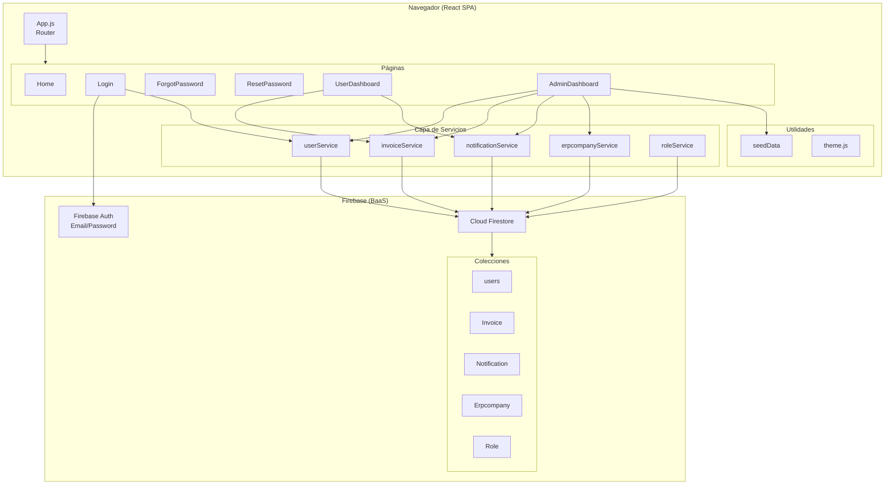
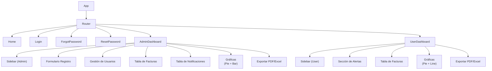

# Zentrix — Arquitectura del Sistema

## Stack Tecnológico

| Capa | Tecnología |
|---|---|
| Frontend | React 19.2.1 |
| Routing | React Router DOM 7.9.5 |
| Backend / DB | Firebase 12.4.0 (Auth + Firestore) |
| Estilos | Tailwind CSS 3.4.18 |
| Gráficas | Chart.js 4.5.1 + react-chartjs-2 5.3.1 |
| Exportar PDF | jsPDF 3.0.3 |
| Exportar Excel | XLSX 0.18.5 |
| Iconos | React Icons 5.5.0 |

---

## Estructura de Archivos

```
src/
├── App.js                  # Definición de rutas
├── index.js                # Punto de entrada React
├── firebase.js             # Configuración e instancias Firebase
│
├── pages/
│   ├── Home.js             # Splash page (redirige a /login)
│   ├── Login.js            # Autenticación de usuarios
│   ├── ForgotPassword.js   # Solicitud de recuperación de contraseña
│   ├── ResetPassword.js    # Confirmación de nueva contraseña
│   ├── UserDashboard.js    # Dashboard para rol Usuario
│   └── AdminDashboard.js   # Dashboard para rol Administrador
│
├── services/
│   ├── constants.js        # Nombres de colecciones Firestore
│   ├── index.js            # Re-exportador de servicios
│   ├── userService.js      # CRUD usuarios
│   ├── invoiceService.js   # CRUD facturas
│   ├── notificationService.js  # CRUD + generación automática de notificaciones
│   ├── erpcompanyService.js    # CRUD empresas ERP
│   └── roleService.js      # CRUD roles (reservado)
│
├── utils/
│   └── seedData.js         # Generación de datos dummy
│
├── components/             # Componentes legacy (no usados en producción)
│   ├── add_doc.js
│   ├── get_doc.js
│   └── get_docs.js
│
└── styles/
    └── theme.js            # Colores y tokens de diseño
```

---

## Diagrama de Arquitectura General



---

## Jerarquía de Componentes



---

## Rutas de la Aplicación

| Ruta | Componente | Acceso |
|---|---|---|
| `/` | Home | Público — redirige a /login en 2 segundos |
| `/login` | Login | Público |
| `/forgot-password` | ForgotPassword | Público |
| `/reset-password` | ResetPassword | Público (via link de email) |
| `/dashboard/admin` | AdminDashboard | Autenticado — rol Admin |
| `/dashboard/user` | UserDashboard | Autenticado — rol User |
| `/*` | — | Redirige a `/` |

> **Nota:** No hay route guards implementados. La protección de rutas depende de la lógica de navegación en `Login.js`.

---

## Colores del Sistema (theme.js)

| Token | Color | Hex |
|---|---|---|
| Primary main | Azul claro | `#29ABE2` |
| Secondary main | Esmeralda | `#10B981` |
| Background default | Gris claro | `#F3F4F6` |
| Sidebar | Azul | `#27aae1` |
| Status success | Verde | `#10B981` |
| Status error | Rojo | `#EF4444` |
| Status warning | Amarillo | `#F59E0B` |
| Status info | Azul | `#3B82F6` |
