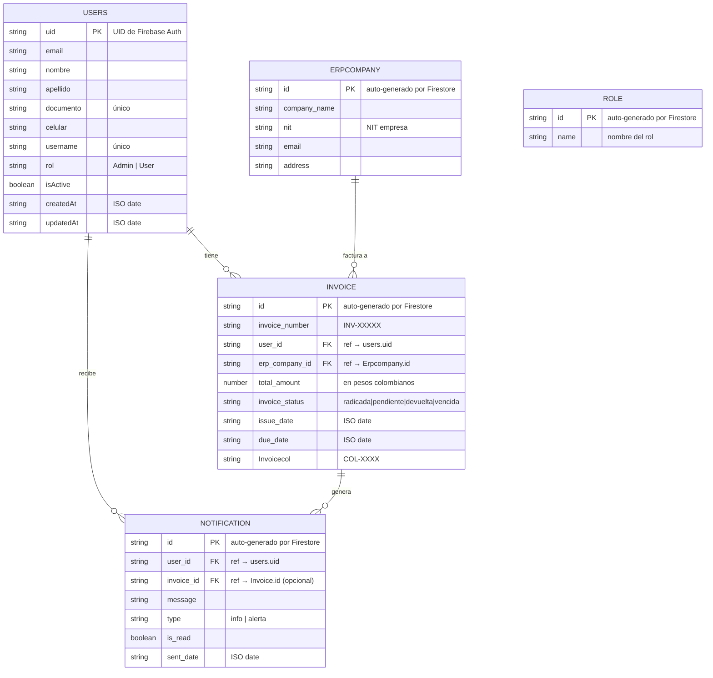

# Zentrix — Esquema de Base de Datos (Firestore)

## Colecciones

Firestore es una base de datos NoSQL orientada a documentos. El proyecto usa **5 colecciones**.

---

## Diagrama Entidad-Relación (ERD)

---

## Detalle por Colección

### `users`
Almacena el perfil de cada usuario registrado en el sistema. El `id` del documento coincide con el UID de Firebase Auth.

| Campo | Tipo | Descripción |
|---|---|---|
| `email` | string | Correo electrónico (único en Auth) |
| `nombre` | string | Primer nombre |
| `apellido` | string | Apellido |
| `documento` | string | Número de documento (único) |
| `celular` | string | Teléfono de contacto |
| `username` | string | Nombre de usuario (único) |
| `rol` | string | `"Admin"` o `"User"` |
| `isActive` | boolean | Estado habilitado/inhabilitado |
| `createdAt` | string | Fecha de creación (ISO 8601) |
| `updatedAt` | string | Última actualización (ISO 8601) |

---

### `Invoice`
Registro de facturas del sistema. Cada factura pertenece a un usuario y a una empresa ERP.

| Campo | Tipo | Descripción |
|---|---|---|
| `invoice_number` | string | Número de factura (ej: `INV-00001`) |
| `user_id` | string | UID del usuario asignado |
| `erp_company_id` | string | ID de la empresa ERP |
| `total_amount` | number | Monto en pesos colombianos |
| `invoice_status` | string | Estado de la factura (ver tabla abajo) |
| `issue_date` | string | Fecha de emisión (ISO 8601) |
| `due_date` | string | Fecha de vencimiento (ISO 8601) |
| `Invoicecol` | string | Código de columna (ej: `COL-1234`) |

**Estados de factura:**

| Estado | Descripción | Genera notificaciones |
|---|---|---|
| `radicada` | Procesada/radicada | No |
| `pendiente` | En proceso, pendiente de pago | Sí |
| `devuelta` | Devuelta para corrección | Sí |
| `vencida` | Plazo vencido | Sí |

---

### `Notification`
Notificaciones automáticas generadas por el sistema basadas en fechas de vencimiento.

| Campo | Tipo | Descripción |
|---|---|---|
| `user_id` | string | UID del usuario destinatario |
| `invoice_id` | string (opcional) | ID de la factura relacionada |
| `message` | string | Texto descriptivo de la alerta |
| `type` | string | `"info"` o `"alerta"` |
| `is_read` | boolean | Si el usuario ya la leyó |
| `sent_date` | string | Fecha de creación (ISO 8601) |

**Tipos de notificación:**

| Tipo | Cuando se genera | UI |
|---|---|---|
| `info` | Factura vence en 8-22 días | Azul |
| `alerta` | Factura vence en 0-7 días o ya venció | Rojo/Amarillo |

---

### `Erpcompany`
Empresas ERP con las que se tiene relación de facturación.

| Campo | Tipo | Descripción |
|---|---|---|
| `company_name` | string | Nombre de la empresa |
| `nit` | string | Número de identificación tributaria |
| `email` | string | Correo de contacto |
| `address` | string | Dirección física |

---

### `Role`
Colección reservada para la gestión de roles (actualmente no utilizada en la UI, la lógica de roles está en el campo `rol` de `users`).

| Campo | Tipo | Descripción |
|---|---|---|
| `name` | string | Nombre del rol |

---

## Reglas de Negocio sobre los Datos

1. Un usuario puede tener **muchas facturas** pero cada factura pertenece a **un solo usuario**.
2. Una factura pertenece a **una sola empresa ERP**.
3. Las notificaciones se generan **automáticamente** al iniciar sesión en el UserDashboard.
4. Se evitan duplicados: no se genera más de **una notificación por factura por día**.
5. Las facturas con estado `radicada` **no generan notificaciones**.
6. El campo `documento` y `username` de usuarios son **únicos** (validado en la app).
