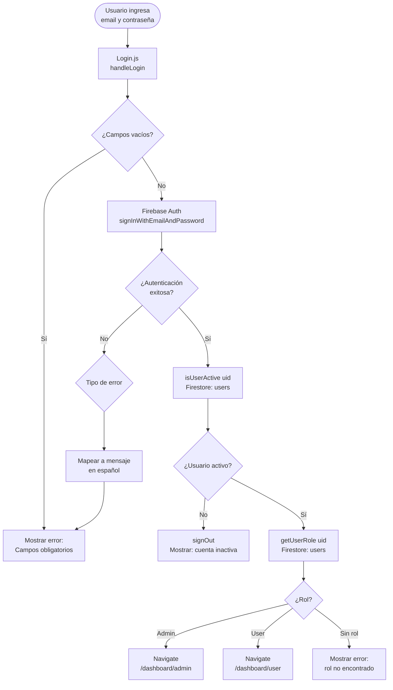
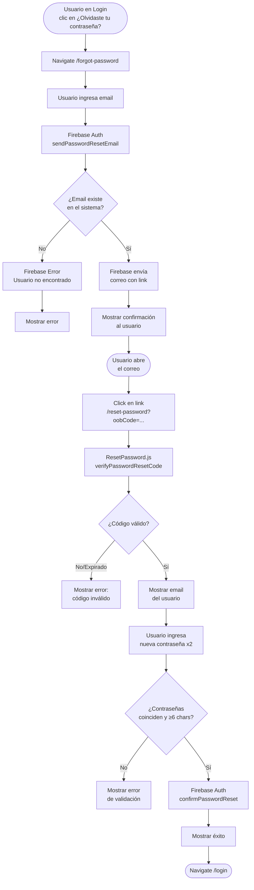
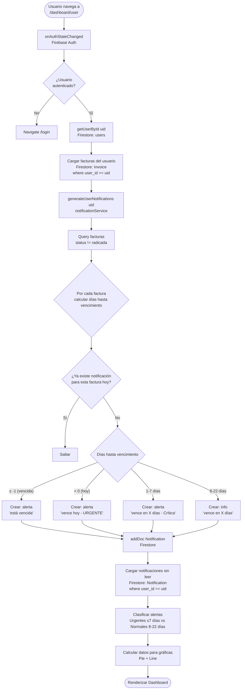
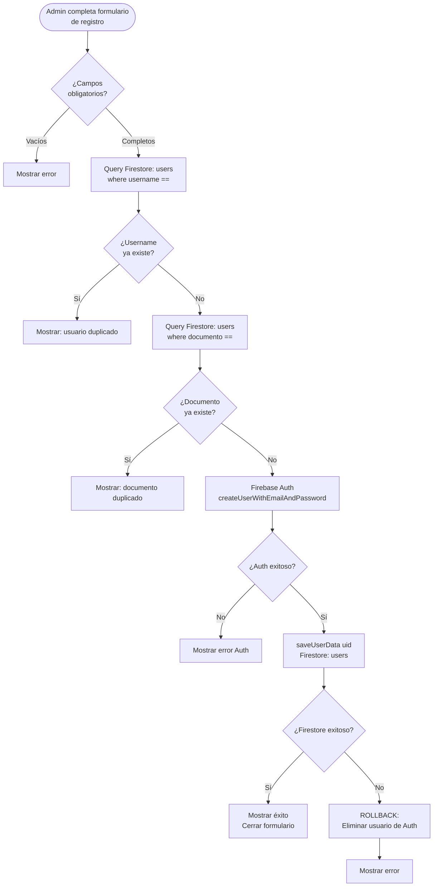
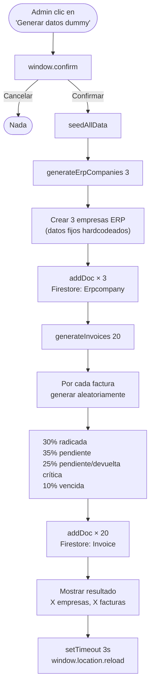
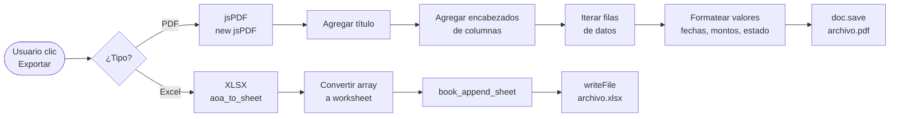

# Zentrix — Diagramas de Flujo de Datos

## 1. Flujo de Autenticación y Login

---

## 2. Flujo de Recuperación de Contraseña

---

## 3. Flujo del UserDashboard (carga de datos)

---

## 4. Flujo de Registro de Usuario (Admin)

---

## 5. Flujo de Generación de Datos Dummy (Seed)

---

## 6. Flujo de Exportación (PDF / Excel)

