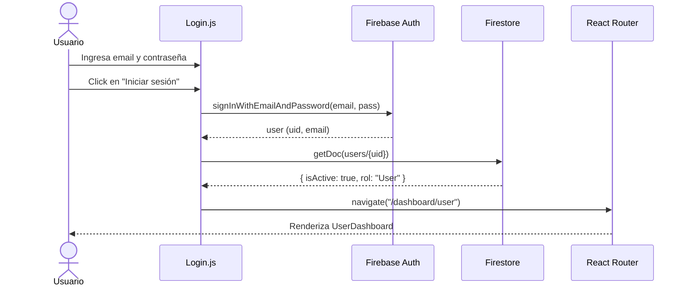
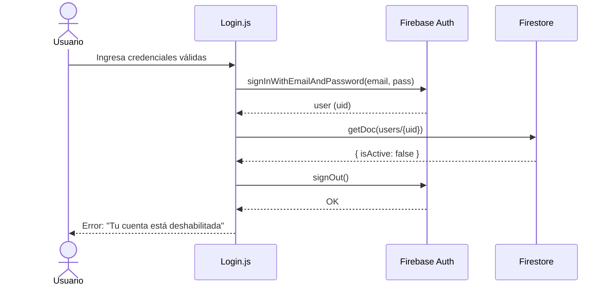
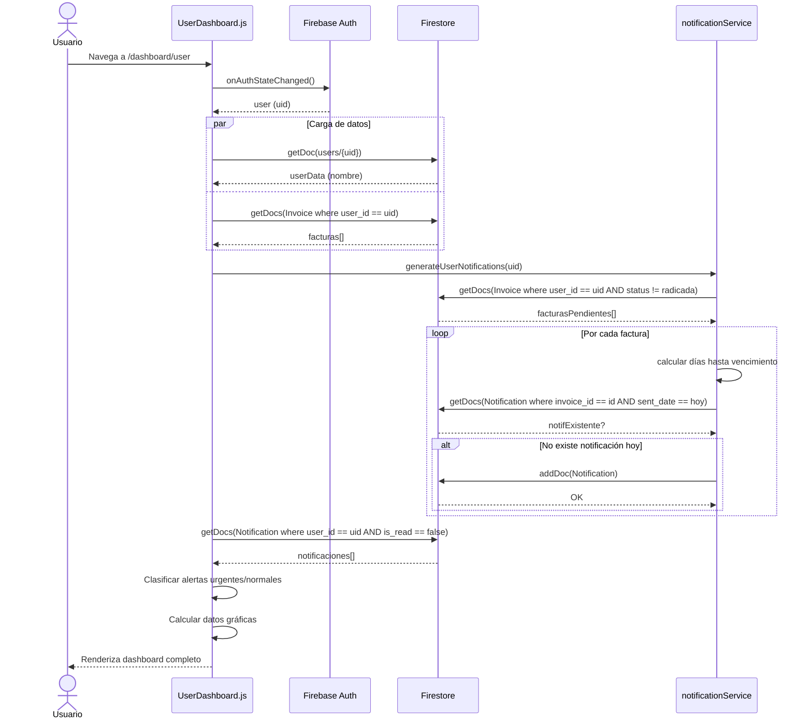
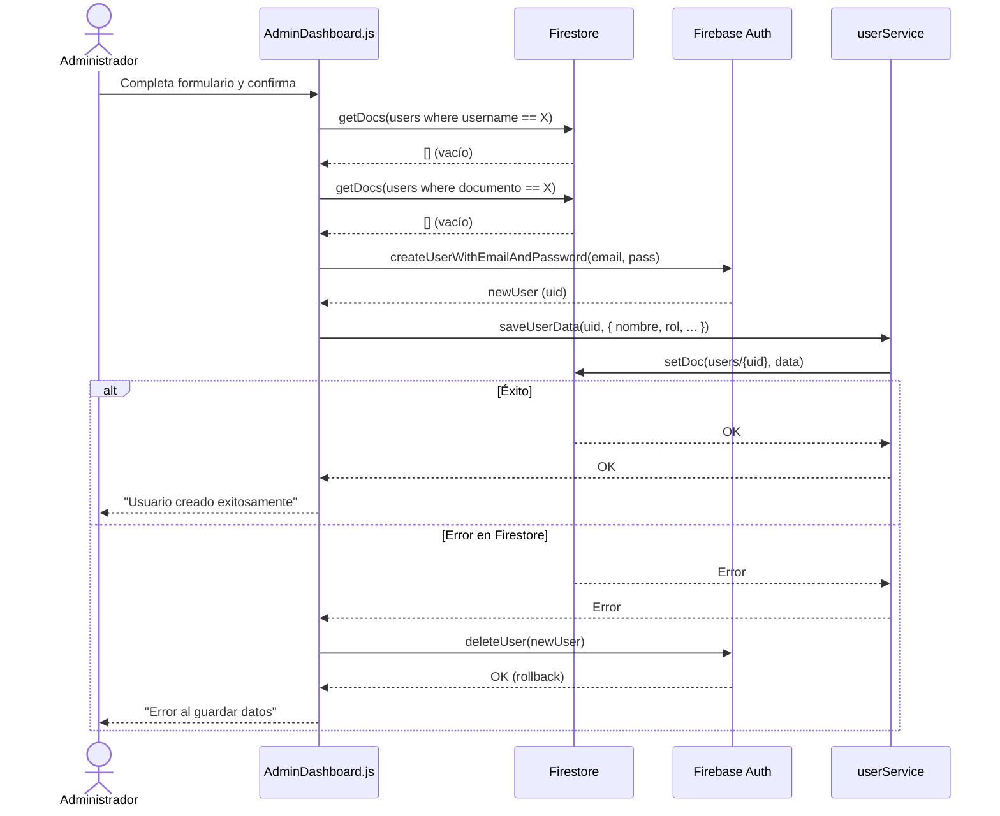
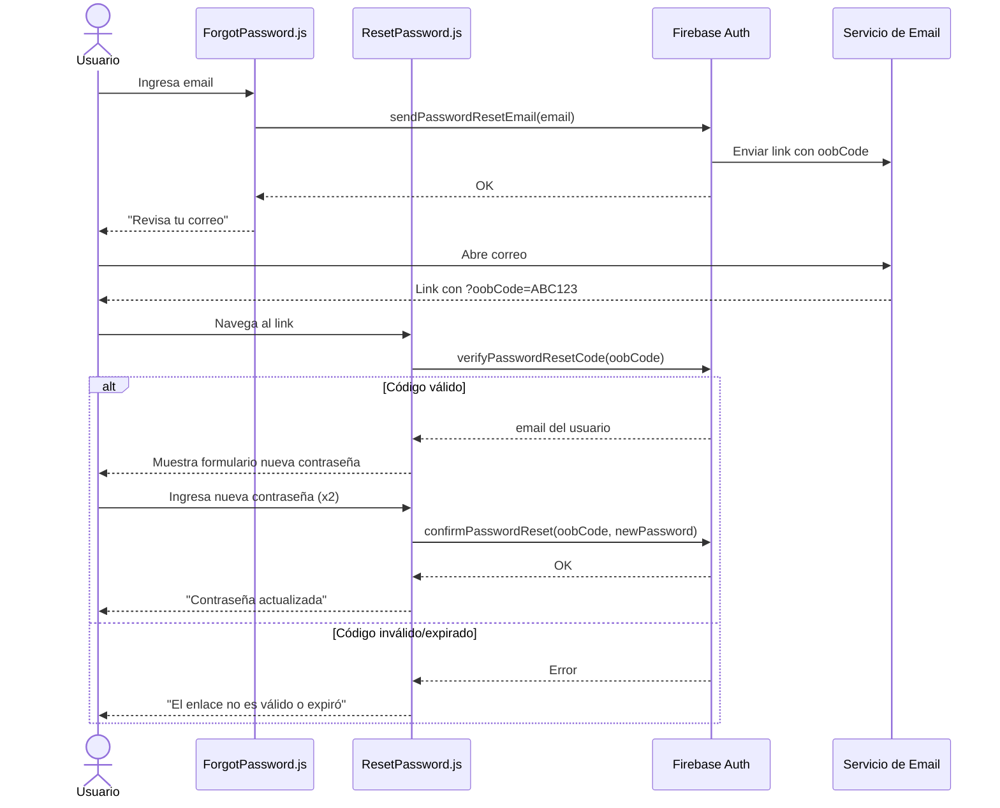
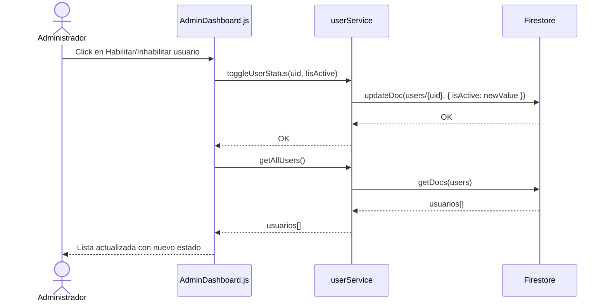

# Zentrix — Diagramas de Secuencia

## 1. Login Exitoso

---

## 2. Login Fallido (usuario inactivo)

---

## 3. Carga del UserDashboard

---

## 4. Registro de Nuevo Usuario (Admin)

---

## 5. Recuperación de Contraseña

---

## 6. Toggle de Estado de Usuario (Admin)

