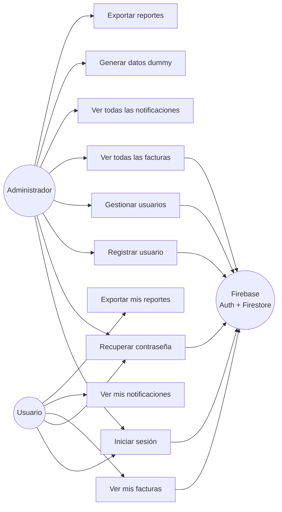
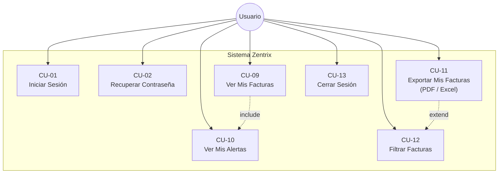
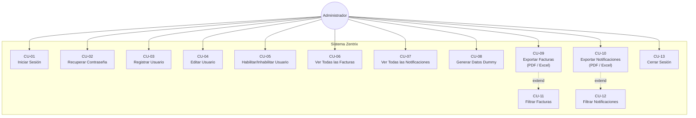

# Zentrix — Casos de Uso

## Diagrama General de Actores

---

## Casos de Uso por Actor

### Actor: Usuario

---

### Actor: Administrador

---

## Descripción de Casos de Uso

### CU-01: Iniciar Sesión
| Campo | Detalle |
|---|---|
| **Actor** | Usuario, Administrador |
| **Precondición** | El usuario tiene una cuenta activa |
| **Flujo principal** | 1. Ingresa email y contraseña → 2. Sistema valida en Firebase Auth → 3. Sistema verifica estado activo en Firestore → 4. Sistema obtiene rol → 5. Redirige al dashboard correspondiente |
| **Flujo alternativo** | Credenciales incorrectas → Mensaje de error en español |
| **Flujo alternativo** | Cuenta inactiva → Cierre de sesión + mensaje de error |
| **Postcondición** | Usuario en su dashboard según rol |

---

### CU-02: Recuperar Contraseña
| Campo | Detalle |
|---|---|
| **Actor** | Usuario, Administrador |
| **Precondición** | El usuario tiene un email registrado |
| **Flujo principal** | 1. Ingresa email → 2. Firebase envía link → 3. Usuario accede al link → 4. Valida código → 5. Ingresa nueva contraseña → 6. Confirma cambio |
| **Flujo alternativo** | Email no registrado → Mensaje de error |
| **Flujo alternativo** | Link expirado → Mensaje de código inválido |
| **Postcondición** | Contraseña actualizada, usuario redirigido a /login |

---

### CU-03: Registrar Usuario
| Campo | Detalle |
|---|---|
| **Actor** | Administrador |
| **Precondición** | Admin autenticado |
| **Flujo principal** | 1. Completa formulario → 2. Valida username único → 3. Valida documento único → 4. Crea en Firebase Auth → 5. Guarda perfil en Firestore |
| **Flujo alternativo** | Username/documento duplicado → Error de validación |
| **Flujo alternativo** | Error en Firestore → Rollback: elimina usuario de Auth |
| **Postcondición** | Nuevo usuario creado con rol y estado activo |

---

### CU-04: Editar Usuario
| Campo | Detalle |
|---|---|
| **Actor** | Administrador |
| **Precondición** | Admin autenticado, usuario existe |
| **Flujo principal** | 1. Selecciona usuario → 2. Modifica campos → 3. Confirma → 4. updateDoc en Firestore |
| **Postcondición** | Datos del usuario actualizados |

---

### CU-05: Habilitar / Inhabilitar Usuario
| Campo | Detalle |
|---|---|
| **Actor** | Administrador |
| **Precondición** | Admin autenticado, usuario existe |
| **Flujo principal** | 1. Click en toggle de estado → 2. toggleUserStatus en Firestore → 3. Lista se actualiza |
| **Efecto** | Usuario con `isActive: false` no puede iniciar sesión |
| **Postcondición** | Estado del usuario actualizado |

---

### CU-06: Ver Facturas
| Campo | Detalle |
|---|---|
| **Actor** | Usuario (solo las propias), Administrador (todas) |
| **Precondición** | Autenticado |
| **Flujo principal** | 1. Carga dashboard → 2. Firestore devuelve facturas filtradas por rol → 3. Se muestran en tabla con estado coloreado |
| **Filtros disponibles** | Número, estado, usuario (solo admin), fecha de emisión, fecha de vencimiento |
| **Postcondición** | Facturas visibles en tabla y gráficas |

---

### CU-07: Exportar Reporte
| Campo | Detalle |
|---|---|
| **Actor** | Usuario, Administrador |
| **Precondición** | Autenticado, datos cargados |
| **Flujo principal** | 1. Click en PDF o Excel → 2. Se genera archivo con datos actuales de la tabla → 3. Descarga automática |
| **Postcondición** | Archivo descargado en el dispositivo |

---

### CU-08: Generar Datos Dummy
| Campo | Detalle |
|---|---|
| **Actor** | Administrador |
| **Precondición** | Admin autenticado |
| **Flujo principal** | 1. Click en "Generar datos" → 2. Confirmación → 3. Crea 3 empresas ERP + 20 facturas → 4. Recarga la página |
| **Nota** | Las notificaciones se generan automáticamente al iniciar sesión |
| **Postcondición** | Datos de prueba disponibles en el sistema |

---

### CU-09: Ver Alertas / Notificaciones
| Campo | Detalle |
|---|---|
| **Actor** | Usuario |
| **Precondición** | Autenticado |
| **Flujo principal** | 1. Carga dashboard → 2. Sistema genera notificaciones automáticas → 3. Clasifica en urgentes (≤7 días) y normales (8-22 días) → 4. Muestra badge con contador |
| **Postcondición** | Usuario informado sobre facturas próximas a vencer |
