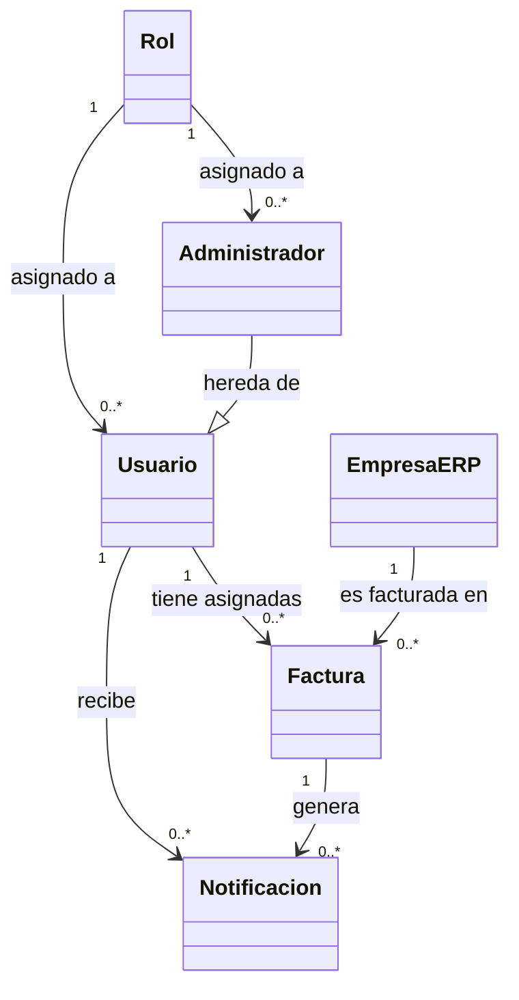

# Zentrix — Modelo de Dominio

---

## Descripción de Entidades

### Usuario
Persona registrada en el sistema con rol **User**. Puede ver y exportar únicamente sus propias facturas y notificaciones.

### Administrador
Extiende a Usuario con rol **Admin**. Tiene acceso total: gestiona usuarios, ve todas las facturas y notificaciones, y puede registrar nuevos usuarios.

### Rol
Define el nivel de acceso dentro del sistema. Valores posibles: `Admin` y `User`.

### Factura
Documento de cobro asociado a un usuario y a una empresa ERP. Tiene un ciclo de vida representado por su **estado**:

| Estado | Descripción |
|---|---|
| `pendiente` | En proceso, pendiente de pago |
| `radicada` | Procesada exitosamente |
| `devuelta` | Devuelta para corrección |
| `vencida` | Plazo de pago superado |

### Notificacion
Alerta generada automáticamente por el sistema cuando una factura está próxima a vencer o ya venció. Se clasifica en:

| Tipo | Condición |
|---|---|
| `info` | La factura vence entre 8 y 22 días |
| `alerta` | La factura vence en 0-7 días o ya está vencida |

### EmpresaERP
Entidad externa (EPS, aseguradora, etc.) con la que se tiene relación de facturación.
