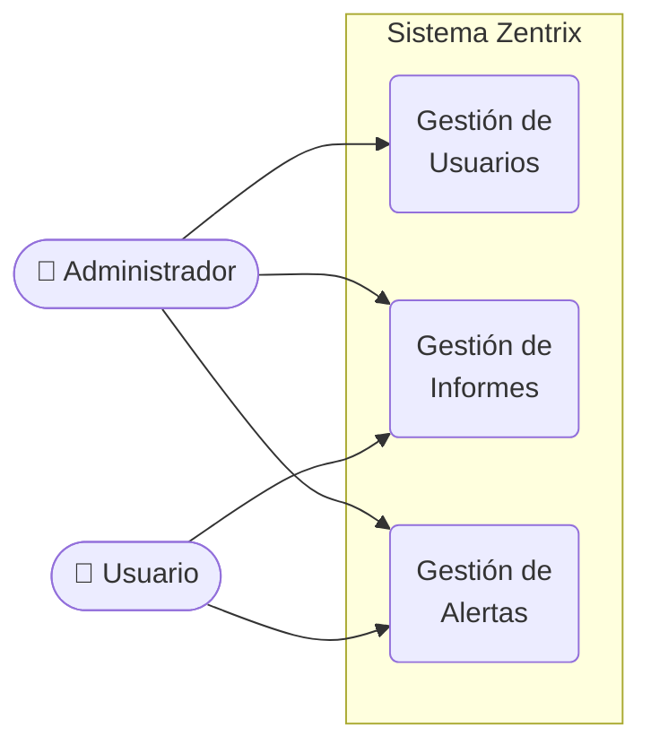

# Zentrix — Modelo de Contexto del Sistema

---

## Actores

| Actor | Descripción |
|---|---|
| **Administrador** | Gestiona usuarios del sistema, revisa todos los informes y monitorea todas las alertas |
| **Usuario** | Consulta sus propios informes de facturas y recibe alertas sobre vencimientos |

## Requisitos Generales

| Requisito | Actor(es) | Descripción |
|---|---|---|
| **Gestión de Usuarios** | Administrador | Registro, edición, habilitación/inhabilitación de usuarios y control de acceso |
| **Gestión de Informes** | Administrador, Usuario | Visualización de facturas, gráficas estadísticas y exportación PDF/Excel |
| **Gestión de Alertas** | Administrador, Usuario | Generación automática y consulta de notificaciones sobre vencimiento de facturas |
