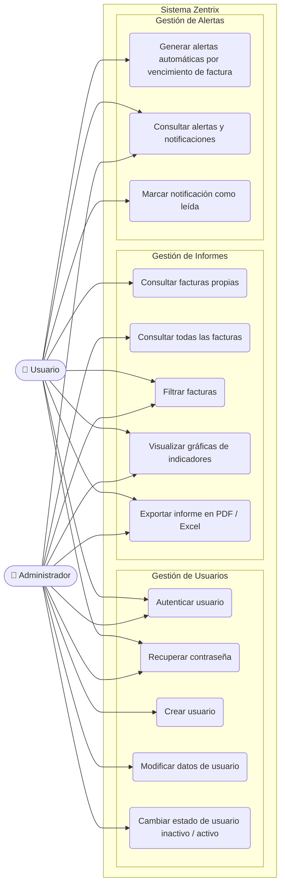

# Zentrix — Modelado de Requisitos del Sistema

---

## Requisitos Funcionales

### Gestión de Usuarios

| ID | Requisito | Actor |
|---|---|---|
| RF01 | Autenticar usuario mediante email y contraseña | Administrador, Usuario |
| RF02 | Recuperar contraseña vía correo electrónico | Administrador, Usuario |
| RF03 | Crear nuevo usuario con rol asignado | Administrador |
| RF04 | Modificar datos de un usuario existente | Administrador |
| RF05 | Cambiar estado de usuario (activo / inactivo) | Administrador |

### Gestión de Informes

| ID | Requisito | Actor |
|---|---|---|
| RF06 | Consultar las facturas propias del usuario | Usuario |
| RF07 | Consultar todas las facturas del sistema | Administrador |
| RF08 | Filtrar facturas por número, estado y fechas | Administrador, Usuario |
| RF09 | Visualizar gráficas de indicadores de facturación | Administrador, Usuario |
| RF10 | Exportar informe de facturas en PDF o Excel | Administrador, Usuario |

### Gestión de Alertas

| ID | Requisito | Actor |
|---|---|---|
| RF11 | Generar alertas automáticas cuando una factura está próxima a vencer o vencida | Usuario |
| RF12 | Consultar alertas y notificaciones del sistema | Administrador, Usuario |
| RF13 | Marcar notificación como leída | Usuario |
