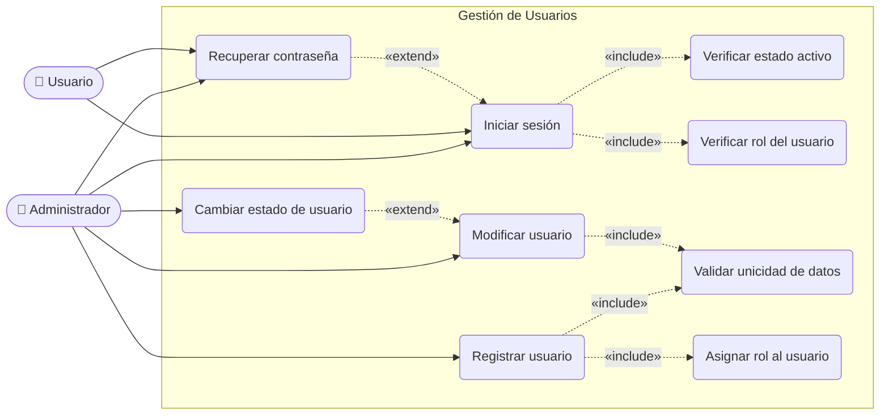
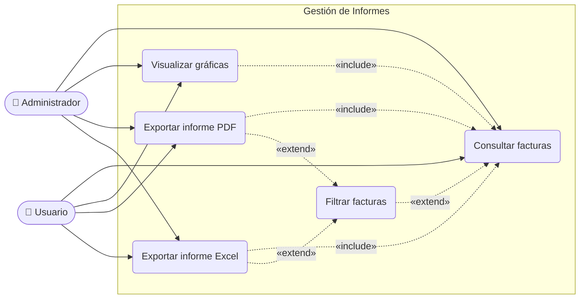
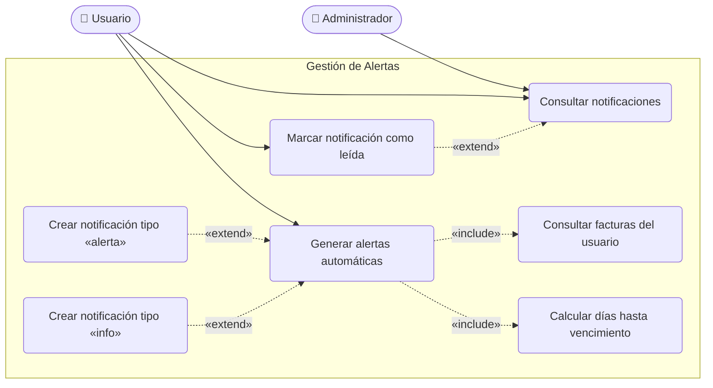

# Zentrix — Comportamiento de Casos de Uso

> Un diagrama por cada requisito general.
> - **«include»**: el caso base **siempre** ejecuta el caso incluido (obligatorio)
> - **«extend»**: el caso extensor **opcionalmente** agrega comportamiento al caso base (condicional)

---

## 1. Gestión de Usuarios

---

## 2. Gestión de Informes

---

## 3. Gestión de Alertas

---

## Leyenda de relaciones

| Notación | Tipo | Significado |
|---|---|---|
| `──────►` | Asociación | El actor participa en el caso de uso |
| `- - -►` «include» | Include | El caso base **siempre** llama al incluido |
| `- - -►` «extend» | Extend | El caso extensor se activa **condicionalmente** |
