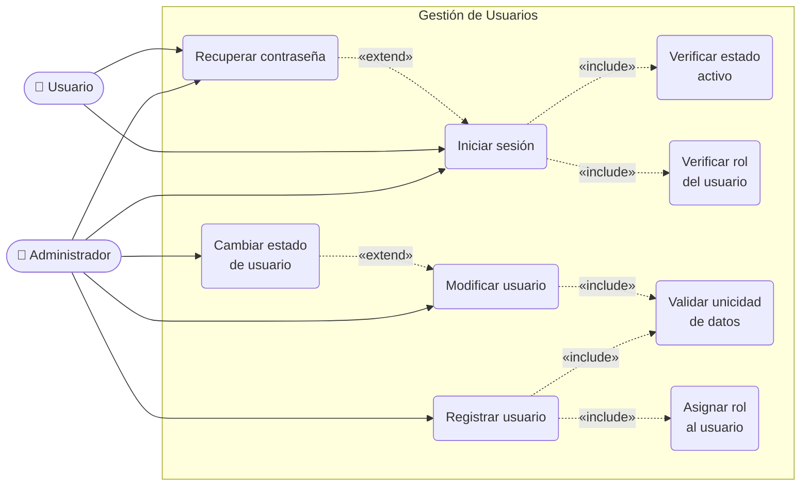
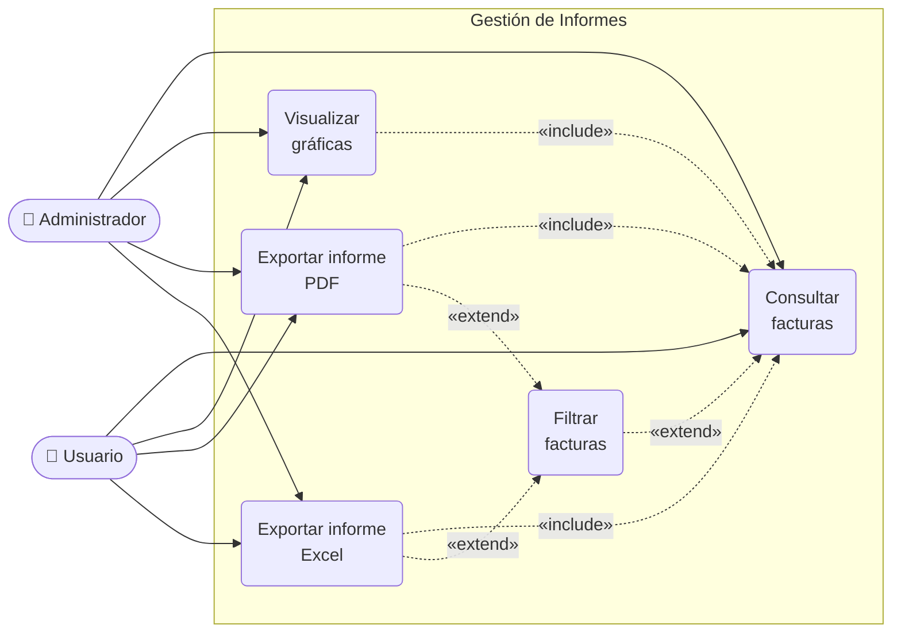
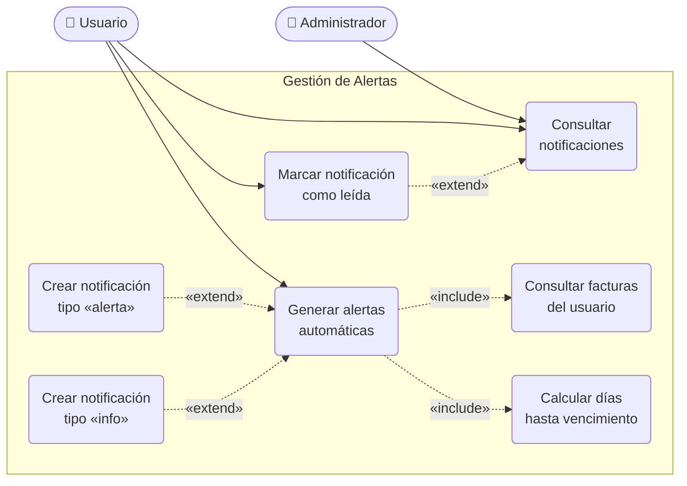

# Zentrix — Comportamiento de Casos de Uso

> Un diagrama por cada requisito general.
> - **«include»**: el caso base **siempre** ejecuta el caso incluido (obligatorio)
> - **«extend»**: el caso extensor **opcionalmente** agrega comportamiento al caso base (condicional)

---

## 1. Gestión de Usuarios

---

## 2. Gestión de Informes

---

## 3. Gestión de Alertas

---

## Leyenda de relaciones

| Notación | Tipo | Significado |
|---|---|---|
| `──────►` | Asociación | El actor participa en el caso de uso |
| `- - -►` «include» | Include | El caso base **siempre** llama al incluido |
| `- - -►` «extend» | Extend | El caso extensor se activa **condicionalmente** |

  Gestión de Usuarios
  - Iniciar sesión «include» verificar estado activo y verificar rol → siempre se ejecutan
  - Recuperar contraseña «extend» iniciar sesión → solo cuando el usuario no puede acceder
  - Registrar usuario «include» validar datos y asignar rol → siempre obligatorio
  - Cambiar estado «extend» modificar usuario → es una acción opcional sobre el usuario

  Gestión de Informes
  - Visualizar gráficas, Exportar PDF/Excel «include» consultar facturas → siempre necesitan los datos primero
  - Filtrar facturas «extend» consultar facturas → opcional
  - Exportar «extend» filtrar → se puede exportar con o sin filtros aplicados

  Gestión de Alertas
  - Generar alertas «include» consultar facturas y calcular días → pasos obligatorios
  - Notificación alerta/info «extend» generar → condicional según los días restantes
  - Marcar como leída «extend» consultar notificaciones → acción opcional del usuario